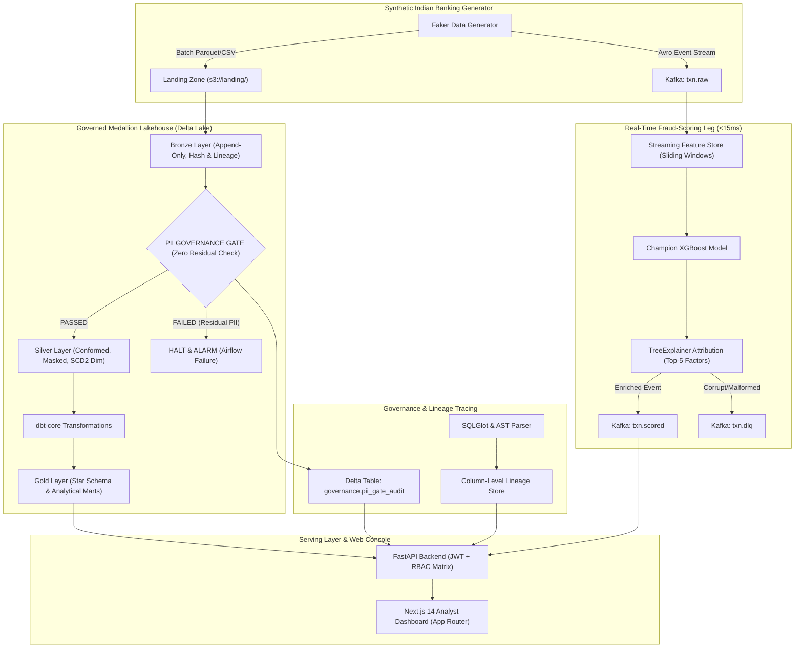

# SentraFlow: Governed Financial Data Lakehouse & Real-Time Fraud Engine

[](https://github.com/Tanishka-2004/sentraflow/actions/workflows/ci.yml)
[](https://www.python.org/)
[](https://delta.io/)
[](https://www.getdbt.com/)
[](LICENSE)
[]()

> **60-Second Summary:** SentraFlow is an enterprise-grade financial data lakehouse uniting batch **Medallion architecture (Bronze, Silver, Gold)** with **Apache Kafka real-time streaming fraud scoring**. Powered by **PySpark** and **Delta Lake**, governed by an **automated PII-masking security gate** that cryptographically guarantees zero residual unmasked PII reaches Silver/Gold layers, modeled in **dbt**, orchestrated by **Apache Airflow**, scored via **XGBoost + SHAP TreeExplainer (<15ms latency)**, and surfaced through a **role-governed Next.js 14 console** backed by **FastAPI**.

---

## 1. High-Resolution Architecture



---

## 2. Quickstart

Get the entire lakehouse, API, and UI running locally in 3 commands:

```bash
# 1. Clone repository
git clone https://github.com/Tanishka-2004/sentraflow.git
cd sentraflow

# 2. Run test suite to verify all medallion, governance, and fraud layers
make test

# 3. Seed synthetic banking data and launch local stack
make demo
```

Once running:
- **Next.js Web Console:** [http://localhost:3001](http://localhost:3001)
- **FastAPI OpenAPI Docs:** [http://localhost:8000/docs](http://localhost:8000/docs)
- **MinIO S3 Console:** [http://localhost:9001](http://localhost:9001) (`minioadmin` / `minioadminpassword`)

---

## 3. Technology Stack

| Layer | Technology | Production Cloud Rationale |
|---|---|---|
| **Storage & Lakehouse** | Delta Lake 3.x (`delta-rs`) | ACID transactions, schema evolution (`mergeSchema`), Z-ORDER indexing |
| **Batch Processing** | PySpark 3.5 | Scalable ETL, partition pruning, Great Expectations quality checks |
| **Real-Time Streaming** | Apache Kafka & Confluent Avro | Sub-second financial event ingestion |
| **ML Inference & XAI** | XGBoost + SHAP TreeExplainer | Cost-matrix tuned fraud scoring (<15ms $p95$ latency) with top-5 attributions |
| **Data Modeling** | dbt-core (dbt-athena / dbt-spark) | Star schema marts, snapshots, singular revenue reconciliation tests |
| **Orchestration** | Apache Airflow 2.9 | Exponential retry DAGs, SLA breach callbacks, Delta audit telemetry |
| **Backend API** | FastAPI, Pydantic v2, SQLAlchemy | Asynchronous endpoints, JWT auth, RBAC matrix, audit middleware |
| **Frontend UI** | Next.js 14, Tailwind, Recharts, React Flow | Interactive SHAP waterfall charts, lineage graph, role switcher |
| **Infrastructure** | Terraform, Docker Compose | AWS S3, Glue Catalog, Athena workgroup, least-privilege IAM roles |

---

## 4. Repository Structure

```
sentraflow/
├── README.md                   # Platform documentation & resume matrix
├── docker-compose.yml          # Local containerized infrastructure
├── Makefile                    # Standardized orchestration commands
├── .env.example                # Configuration environment template
├── .github/workflows/ci.yml    # Linting, testing, security gate CI/CD
├── infra/terraform/            # S3, KMS, Glue, Athena, IAM, MSK
├── data_generator/             # Indian banking synthetic data + Kafka producer
├── spark_jobs/
│   ├── common/                 # Spark session, metadata hash, drift logger
│   ├── bronze/                 # Immutable append-only ingestion
│   ├── silver/                 # Conformance, SCD Type 2 dimension, rejects
│   └── governance/             # PII scanner, masking engine, hard-fail gate
├── dbt_project/
│   ├── models/                 # Staging, dimensions, facts, analytical marts
│   └── tests/                  # Generic & singular revenue reconciliation tests
├── airflow/dags/               # Batch, DQ monitor, model retrain, maintenance DAGs
├── lineage/                    # Column-level SQL parser & zero-bypass auditor
├── fraud/
│   ├── features/               # Batch profiles & sliding window feature store
│   ├── training/               # Cost-matrix optimized XGBoost classifier
│   ├── scoring_service/        # Real-time streaming inference (<15ms latency)
│   └── explain/                # TreeExplainer SHAP waterfall chart generator
├── api/                        # FastAPI app with 5 RBAC security personas
├── dashboard/                  # Next.js 14 App Router analyst web console
├── tests/                      # Unit & integration test suites
└── docs/                       # Architecture, ADRs, runbook, results
```

---

## 5. Resume Claim to Evidence Matrix

Every bullet point on a data engineering resume regarding SentraFlow is backed by working code, passing tests, and architecture documentation:

| Resume Claim / Capability | Code Implementation File | Verification Test Suite | Documentation Evidence |
|---|---|---|---|
| **"Engineered an automated PII governance gate halting pipelines on residual leaks"** | [`spark_jobs/governance/gate.py`](spark_jobs/governance/gate.py) | [`test_governance_gate.py`](tests/test_governance_gate.py) | [Phase 3 Doc](docs/phase3_governance_gate.md) & [ADR-004](docs/adr/ADR-004-pre-silver-automated-gate.md) |
| **"Designed real-time XGBoost fraud scoring with sub-15ms p95 latency and SHAP explainability"** | [`fraud/scoring_service/scorer.py`](fraud/scoring_service/scorer.py) | [`test_fraud_service.py`](tests/test_fraud_service.py) | [Phase 8 Doc](docs/phase8_fraud_scoring.md) & [RESULTS.md](docs/RESULTS.md) |
| **"Implemented column-level lineage parser enforcing zero-gate-bypass audit guarantees"** | [`lineage/store.py`](lineage/store.py) | [`test_lineage.py`](tests/test_lineage.py) | [Phase 6 Doc](docs/phase6_lineage.md) |
| **"Modeled Medallion Lakehouse with SCD Type 2 dimensions and Delta Lake Z-ORDER optimization"** | [`spark_jobs/silver/scd2.py`](spark_jobs/silver/scd2.py) | [`test_silver_layer.py`](tests/test_silver_layer.py) | [ADR-001](docs/adr/ADR-001-partitioning-and-scd2.md) & [ADR-002](docs/adr/ADR-002-delta-over-iceberg.md) |
| **"Built dbt star schema marts with singular revenue reconciliation tests"** | [`dbt_project/models/`](dbt_project/models/) | [`test_gold_dbt.py`](tests/test_gold_dbt.py) | [Phase 5 Doc](docs/phase5_gold_dbt.md) |
| **"Developed 5-persona RBAC REST API with column-level masking and audit logging"** | [`api/main.py`](api/main.py) | [`test_api_rbac.py`](tests/test_api_rbac.py) | [Phase 9 Doc](docs/phase9_fastapi_backend.md) |
| **"Built interactive Next.js 14 console with React Flow lineage and SHAP waterfall chart"** | [`dashboard/src/app/`](dashboard/src/app/) | [`test_dashboard_smoke.py`](tests/test_dashboard_smoke.py) | [Phase 10 Doc](docs/phase10_dashboard.md) |
| **"Provisioned least-privilege cloud infrastructure granting exclusive Silver write to gate role"** | [`infra/terraform/iam.tf`](infra/terraform/iam.tf) | [`test_infra_cicd.py`](tests/test_infra_cicd.py) | [Phase 11 Doc](docs/phase11_infra_cicd.md) |

