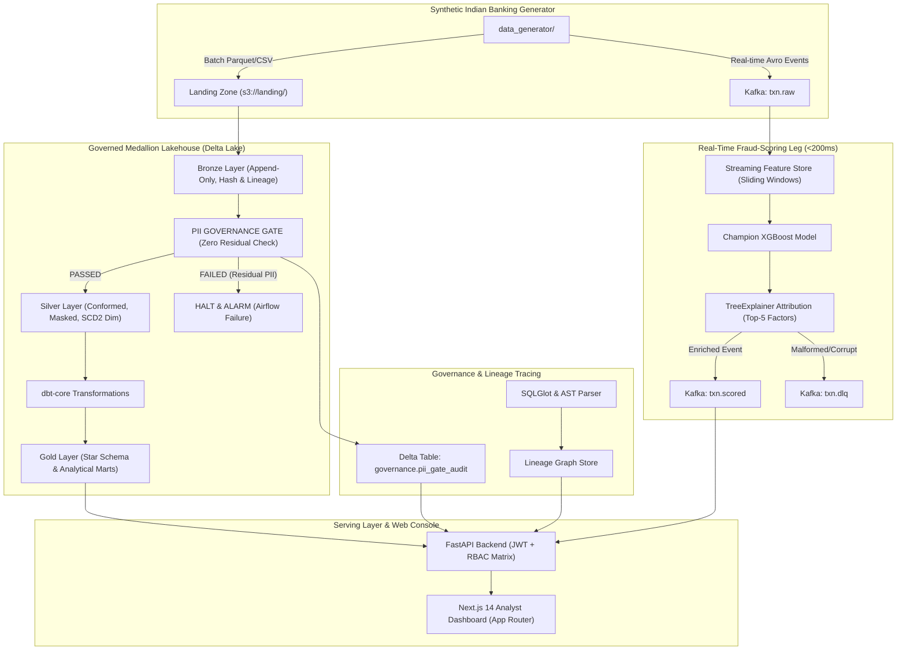

# SentraFlow System Architecture Documentation

## 1. End-to-End System Architecture

SentraFlow is an enterprise-grade, governed financial data lakehouse uniting batch medallion lakehouse processing with real-time streaming machine learning inference.

## 2. Layer Responsibilities & Guarantees

### 2.1 Landing Zone (`s3://sentraflow-landing/`)
- Inbound drop-zone for raw Parquet and CSV files from banking core systems.
- Partitioned by `source_system` and `ingest_date`.

### 2.2 Bronze Layer (`s3://sentraflow-bronze/`)
- **Guarantees:** Immutable, raw, append-only Delta Lake tables.
- **Audit Metadata Injected:** `_ingest_ts`, `_source_file`, `_batch_id`, `_schema_version`, `_record_hash`.
- **Schema Drift Handling:** Automatically handles column additions via Delta `mergeSchema` and writes audit telemetry to `governance.schema_drift_log`.
- **Quarantine:** Unparseable records routed to `bronze_quarantine/` with failure diagnostics.

### 2.3 Governance PII Gate (`spark_jobs/governance/`)
- Hard-stop security checkpoint positioned between Bronze and Silver.
- Performs dual-pass inspection:
  1. Registry-based classification lookup (`classification_registry.yaml`).
  2. Content-based regular expression scanning across 8 financial PII types.
- Applies cryptographic HMAC-SHA256 tokenization, partial redaction, or email hashing per policy.
- **Residual PII Verification:** Re-scans output DataFrame. If any unmasked PII is discovered, halts pipeline with zero writes to Silver.

### 2.4 Silver Layer (`s3://sentraflow-silver/`)
- Conformed and standardized: E.164 phone normalization, ISO-3166 state codes, UTC timestamps.
- Great Expectations quality enforcement; failing records routed to `silver_rejects`.
- Slowly Changing Dimension (SCD Type 2) tracking customer address and KYC history using Delta `MERGE`.

### 2.5 Gold Layer (`s3://sentraflow-gold/`)
- Dimensional star schema modeled and tested via **dbt**:
  - Dimensions: `dim_customer` (SCD2 snapshot), `dim_account`, `dim_merchant`, `dim_channel`, `dim_date`.
  - Facts: `fct_transactions`, `fct_fraud_scores`.
  - Marts: `mart_daily_spend_by_segment`, `mart_merchant_risk`, `mart_customer_360`, `mart_fraud_kpis`, `mart_data_quality_scorecard`.
- Singular assertion test verifying revenue reconciliation between Silver and Gold within 0.01% tolerance.

### 2.6 Streaming Fraud Engine (`fraud/`)
- Independent high-throughput scoring path.
- Computes behavioral sliding metrics: transactions in last 1/5/60 min, rolling sum in 10 min, Haversine geospatial velocity (impossible travel >800 km/h), device novelty, and night transaction flags.
- XGBoost inference with calibrated cost-matrix decision threshold.
- Sub-200ms latency with TreeExplainer top-5 SHAP feature explanations.

### 2.7 REST API & Analyst Console (`api/` & `dashboard/`)
- FastAPI backend implementing 5 RBAC security personas.
- Response column filtering ensuring raw PII is never exposed to analysts or models.
- Next.js 14 console with React Flow lineage visualization, live fraud review queue, and interactive SHAP waterfall attribution charts.

