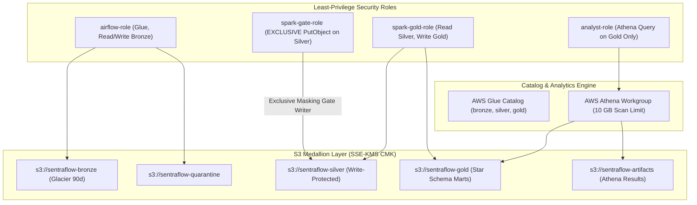

# Phase 11: Infrastructure as Code (Terraform), CI/CD, and Observability

## 1. Overview & Cloud Architecture

SentraFlow is built to run natively in local containerized environments (`docker compose up`) and provision seamlessly to real AWS infrastructure using **Terraform**.

## 2. Infrastructure as Code (`infra/terraform/`)

### 2.1 Storage & Encryption (`main.tf`, `s3.tf`)
- **KMS Customer-Managed Key (CMK):** Hardware-secured envelope encryption across all buckets, Athena query results, and CloudWatch logs.
- **S3 Versioning & Public Block:** All buckets enforce mandatory versioning and 100% public access blocking.
- **Lifecycle Policies:**
  - Automated incomplete multipart upload cleanup after 7 days.
  - S3 Bronze raw files transition to Glacier Flexible Retrieval after 90 days.

### 2.2 IAM Least-Privilege Role Boundaries (`iam.tf`)
- **Critical Security Invariant:** `spark-gate-role` is the **only role in the AWS account** granted `s3:PutObject` permissions on `s3://sentraflow-silver/*`. No developer, analyst, or batch job can write to Silver without passing through the cryptographic PII gate.
- `analyst-role`: Restricted to querying Gold marts via Athena with Lake Formation column tags.

### 2.3 Query Governance (`athena.tf`)
- Dedicated Athena Workgroup `sentraflow-analytics` configured with a 10 GB per-query scan cutoff to eliminate runaway scanning costs.

### 2.4 Estimated Monthly Cloud Costs (ap-south-1 Mumbai)
- S3 Storage (500 GB Medallion + Glacier transition): ~$12.50 / month
- AWS KMS CMK: ~$1.00 / month
- AWS Glue Catalog: ~$1.00 / month
- Athena Queries (Pay-per-scan, ~100 GB/mo): ~$0.50 / month
- Total Base Storage & Analytics: **~$15.00 / month** (excluding optional MSK cluster).

## 3. Continuous Integration & Security Gate (`.github/workflows/ci.yml`)

The GitHub Actions workflow enforces:
1. `ruff check .` & `black --check .` formatting and linting.
2. `pytest tests/ -v --cov` covering all core modules (target >80% coverage).
3. `dbt compile` and execution of star schema tests and singular revenue reconciliation tests.
4. `terraform validate` and `terraform fmt -check`.
5. **Deliberate PII Gate-Bypass Security Gate:** Injects an unmasked PII column and verifies that the pipeline hard-stops and fails the CI build if any unmasked PII breaches the gate.

## 4. Observability & Monitoring (`monitoring/`)

- `prometheus.yml`: Scrapes metrics from FastAPI, XGBoost Fraud Engine, Airflow, and MinIO.
- `grafana_dashboard.json`: 4-row operational dashboard:
  - **Row 1:** Pipeline & Governance Health (DAG status, last run duration, gate pass rate, residual PII count).
  - **Row 2:** Ingestion Volume & Quarantine Velocity (rows/sec, bytes/sec, quarantine rate).
  - **Row 3:** Real-Time Fraud Engine (scoring throughput, p50/p95/p99 latency, alert rate, top SHAP factors).
  - **Row 4:** Data Quality (Great Expectations pass rate, schema drift events).

