# Phase 7: Orchestration & Airflow DAGs

## 1. Overview & Architecture

SentraFlow uses **Apache Airflow 2.9** for orchestrating batch workloads, quality monitoring, machine learning retraining, and lakehouse storage maintenance. The orchestration layer guarantees strict task dependencies, automatic retries with exponential backoff, SLA breach monitoring, and audit logging to the Delta Lake audit table.

```mermaid
flowchart TD
    subgraph sentraflow_batch_pipeline ["DAG: sentraflow_batch_pipeline (Hourly @hourly)"]
        S1[check_landing_sensor] --> S2[ingest_raw_bronze]
        S2 --> S3[run_pii_governance_gate]
        S3 --> S4[process_silver_conformed]
        S4 --> S5[run_dbt_gold_marts]
        S5 --> S6[emit_pipeline_lineage]
    end

    subgraph sentraflow_dq_monitor ["DAG: sentraflow_dq_monitor (Daily @daily)"]
        D1[check_source_freshness] --> D2[run_great_expectations_checks]
        D2 --> D3[run_dbt_singular_tests]
        D3 --> D4[publish_dq_scorecard]
    end

    subgraph sentraflow_model_retrain ["DAG: sentraflow_model_retrain (Weekly @weekly)"]
        M1[extract_gold_training_features] --> M2[evaluate_concept_drift]
        M2 --> M3[train_xgboost_classifier]
        M3 --> M4[benchmark_pr_auc_and_register]
    end

    subgraph sentraflow_maintenance ["DAG: sentraflow_maintenance (Weekly @weekly)"]
        W1[optimize_zorder_silver_gold] --> W2[vacuum_historical_snapshots]
    end
```

## 2. Implemented DAGs

### 2.1 `sentraflow_batch_pipeline`
- **Schedule:** `@hourly`
- **Retry Policy:** 2 retries, 60s exponential delay (`retry_exponential_backoff=True`).
- **SLA:** 30 minutes execution window with `sla_miss_slack_alert` alerting.
- **Workflow:**
  1. `check_landing_sensor`: Verifies availability of new Parquet landing files.
  2. `ingest_raw_bronze`: Append-only Delta ingestion (`spark_jobs/bronze/ingest_batch.py`) recording `_ingest_ts`, `_batch_id`, and `_record_hash`.
  3. `run_pii_governance_gate`: Hard-stop security validation (`spark_jobs/governance/gate.py`). Fails the DAG if residual PII is detected.
  4. `process_silver_conformed`: Conforms fields, enforces E.164 phone and ISO state codes, runs Great Expectations checks, rejects malformed rows, and merges SCD2 dimensions.
  5. `run_dbt_gold_marts`: Materializes the star schema (`dim_*`, `fct_*`) and 5 analytical marts (`mart_daily_spend_by_segment`, `mart_merchant_risk`, `mart_customer_360`, `mart_fraud_kpis`, `mart_data_quality_scorecard`).
  6. `emit_pipeline_lineage`: Parses SQL definitions and registers column-level lineage graph in the metadata database.

### 2.2 `sentraflow_dq_monitor`
- **Schedule:** `@daily`
- Validates landing freshness, calculates reject ratios, executes singular revenue reconciliation tests, and logs quality KPIs to `governance.dq_scorecard`.

### 2.3 `sentraflow_model_retrain`
- **Schedule:** `@weekly`
- Evaluates recent fraud labels from `fct_transactions` and `fct_fraud_scores`, tests for population drift, retrains the XGBoost classifier with `scale_pos_weight`, evaluates PR-AUC against the production baseline, and updates the MLflow Model Registry.

### 2.4 `sentraflow_maintenance`
- **Schedule:** `@weekly`
- Runs Delta Lake `OPTIMIZE ... Z-ORDER BY (customer_id, txn_ts)` and `VACUUM RETAIN 168 HOURS` (7-day time travel retention) across Bronze, Silver, and Gold tables.

## 3. Plugins & Monitoring Callbacks

- `airflow/plugins/alerts.py`:
  - `slack_failure_alert`: Formats rich Slack Block Kit alerts with DAG ID, task instance, execution date, log URL, and exception traceback.
  - `sla_miss_slack_alert`: Emits real-time SLA miss notifications with elapsed duration and blocking task identification.
- `airflow/plugins/audit_logger.py`:
  - `PipelineRunAuditLogger`: Appends immutable execution telemetry to Delta Lake (`governance.pipeline_run_audit`), recording `dag_id`, `run_id`, `execution_ts`, `status`, `duration_seconds`, and records processed.

## 4. Testing & Verification

Unit tests in `tests/test_airflow_dags.py` verify:
1. Syntax integrity and importability across all 4 DAG definitions.
2. Correct task dependency hierarchy and retry configurations (`retries=2`, `retry_delay=60s`).
3. Payload schema and formatting of Slack alert callbacks.
4. Delta audit log persistence via `PipelineRunAuditLogger`.

