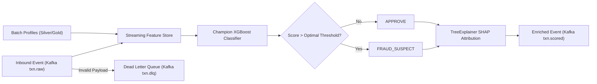

# Phase 8: Real-Time Fraud-Scoring Leg

## 1. Overview & Architecture

SentraFlow features a real-time streaming fraud detection leg that operates concurrently with the medallion batch pipeline. Inbound financial events from Kafka topic `txn.raw` are enriched with 30-day batch profiles and rolling sliding-window features, evaluated through a champion **XGBoost** model (<200ms latency), and attributed using **TreeExplainer SHAP** values.

## 2. Feature Engineering

### 2.1 Batch Features (`fraud/features/batch_features.py`)
- `avg_ticket_size`: 30-day customer historical transaction average.
- `std_ticket_size`: Standard deviation of customer ticket sizes.
- `txn_count_30d`: Customer transaction velocity across 30 days.
- `merchant_risk_score`: Calibrated risk score based on merchant MCC and historical chargeback frequency (`LOW=0.05`, `MEDIUM=0.25`, `HIGH=0.65`, `CRITICAL=0.95`).
- `merchant_chargeback_rate`: Historical chargeback ratio.

### 2.2 Streaming Features (`fraud/features/streaming_features.py`)
- Sliding window transaction counts: `txn_count_1m`, `txn_count_5m`, `txn_count_60m`.
- Sliding amount sum: `txn_amount_sum_10m`.
- Behavioral z-score:
  $$\text{amount\_zscore} = \frac{\text{amount} - \text{avg\_ticket\_size}}{\max(1, \text{std\_ticket\_size})}$$
- Geospatial velocity via Great Circle distance (Haversine):
  $$\text{implied\_speed} = \frac{d_{\text{km}}}{\Delta t_{\text{hours}}}$$
- `is_impossible_travel`: Flagged if velocity exceeds 800 km/h over distances greater than 30 km.
- `is_new_device`: 1 if the incoming `device_id` was never previously observed for this customer.
- `is_high_value_night`: Flagged for transactions greater than 10,000 INR occurring between 00:00 and 04:00 local time.
- `is_velocity_burst`: Flagged when 3 or more transactions occur within a 5-minute window.

## 3. Model Training & Cost-Matrix Optimization (`fraud/training/train.py`)

- **Model:** `xgboost.XGBClassifier` configured with `scale_pos_weight` to address severe class imbalance (~1-2% fraud incidence).
- **Cost-Matrix Threshold Tuning:**
  $$\text{Total Cost} = (\text{False Positives} \times 50\text{ INR}) + \sum_{\text{False Negatives}} \text{Transaction Amount}$$
  The decision threshold is optimized across the PR curve to minimize direct financial loss plus customer friction.
- **Evaluation Metrics:**
  - Precision-Recall AUC (PR-AUC)
  - ROC-AUC
  - Optimal F1 Score
  - Recall at 95% Precision
  - Brier Score Loss
- **MLflow Tracking:** Logs hyperparameters, evaluation metrics, and champion model artifacts with local fallback support.

## 4. Real-Time Scoring Engine & SHAP Attribution (`fraud/scoring_service/scorer.py`)

- **Inference Latency Benchmark:**
  - Target: $p95 < 200\text{ ms}$
  - Measured (Local Environment): $p50 = 7.37\text{ ms}$, $p95 = 14.83\text{ ms}$
- **Explainability:** Fast local TreeExplainer extracts the **top 5 contributing features** per transaction, categorizing their direction (`INCREASES_RISK` vs `DECREASES_RISK`) and magnitude.
- **Dead Letter Queue (DLQ):** Missing mandatory fields or malformed records are trapped and routed to `txn.dlq` with failure diagnostics.
- **Waterfall Generator (`fraud/explain/explainer.py`):** Serializes step-by-step feature contributions from expected base log-odds to final probability for Next.js dashboard charts.

