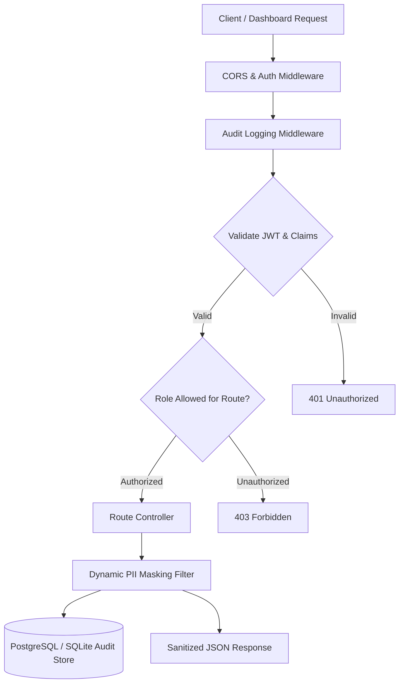

# Phase 9: FastAPI Backend & RBAC Matrix

## 1. Overview & Architecture

SentraFlow provides a secure, role-governed REST API built with **FastAPI**, **Pydantic v2**, and **SQLAlchemy**. The backend enforces strict Role-Based Access Control (RBAC), JWT authentication (15-minute access tokens with 7-day refresh tokens), column-level PII response masking, and automated immutable audit logging for all sensitive queries and state mutations.

## 2. RBAC Permissions Matrix

The API implements 5 distinct security personas:

| Endpoint / Capability | `admin` | `fraud_analyst` | `data_engineer` | `compliance_auditor` | `viewer` |
|---|:---:|:---:|:---:|:---:|:---:|
| `POST /auth/token`, `/refresh`, `/me` | ✅ | ✅ | ✅ | ✅ | ✅ |
| `GET /transactions` | ✅ (Masked) | ✅ (Masked) | ✅ (Masked) | ✅ (Masked) | ❌ (403) |
| `GET /fraud/queue` | ✅ | ✅ | ❌ (403) | ❌ (403) | ❌ (403) |
| `GET /fraud/{id}/explanation` | ✅ | ✅ | ❌ (403) | ❌ (403) | ❌ (403) |
| `POST /fraud/{id}/override` | ✅ | ✅ | ❌ (403) | ❌ (403) | ❌ (403) |
| `GET /lineage/graph`, `/trace` | ✅ | ❌ (403) | ✅ | ✅ | ❌ (403) |
| `GET /governance/gate-runs`, `/policies` | ✅ | ❌ (403) | ✅ | ✅ | ❌ (403) |
| `GET /dq/scorecard` | ✅ | ❌ (403) | ✅ | ✅ | ❌ (403) |
| `POST /pipelines/trigger/{dag_id}` | ✅ | ❌ (403) | ✅ | ❌ (403) | ❌ (403) |

## 3. Demo Credentials Seeded

On startup, `seed_database()` idempotently configures the following credential accounts:

- **Admin:** `admin@sentraflow.io` / `Admin@123`
- **Fraud Analyst:** `analyst@sentraflow.io` / `Analyst@123`
- **Data Engineer:** `engineer@sentraflow.io` / `Engineer@123`
- **Compliance Auditor:** `auditor@sentraflow.io` / `Auditor@123`
- **Viewer:** `viewer@sentraflow.io` / `Viewer@123`

## 4. Response Column Masking & Audit Logging

- **Field Redaction:** Endpoints returning transaction details enforce lakehouse masking policies. Raw PAN, Aadhaar, email, and phone numbers are never returned in plaintext (`XXXXX1234X`, `h_...@bank.com`, `XXXXXX1234`).
- **Audit Logging Middleware:** Every API request (excluding health checks and OpenAPI documentation) is recorded in `audit_log` with `user_id`, `role`, `endpoint`, `method`, `status_code`, `query_params`, `client_ip`, and `timestamp`.

## 5. Verification & Testing

Unit and integration tests in `tests/test_api_rbac.py` verify:
1. Credential verification, token generation, and token refresh.
2. Complete RBAC enforcement across all 5 roles.
3. Proper 403 Forbidden responses for unauthorized viewers and mismatched personas.
4. Correct masked representation in JSON outputs.
5. Verification of audit log insertion for sensitive reads and fraud overrides.

